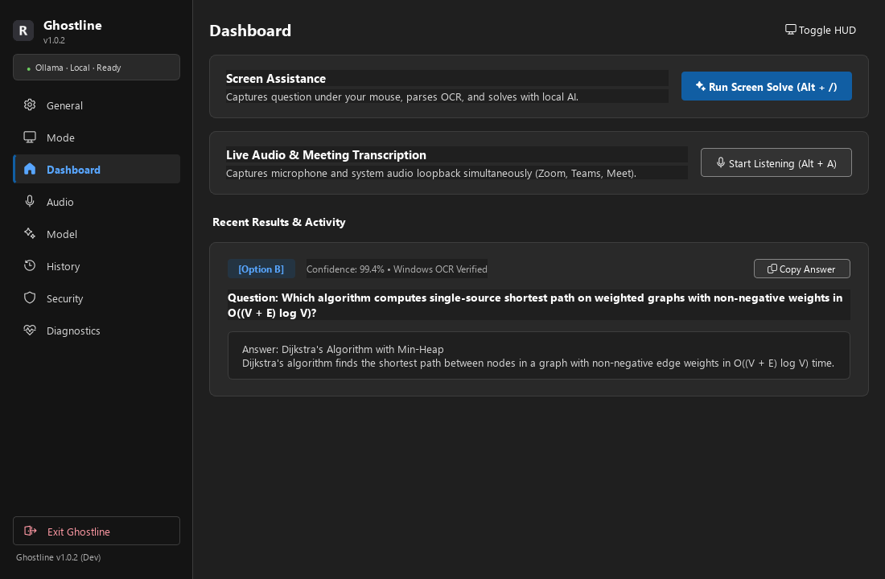
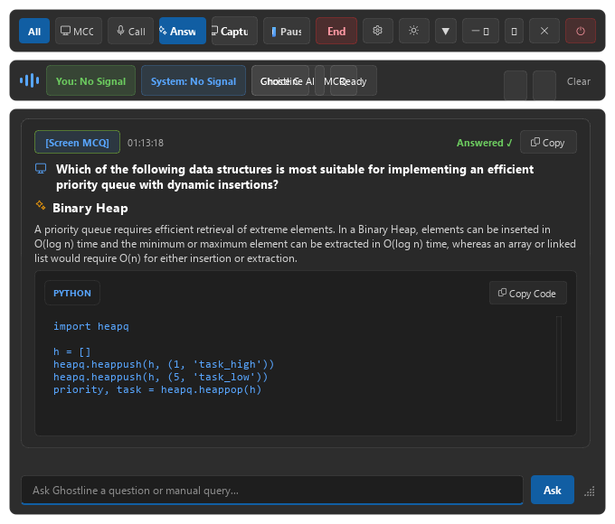
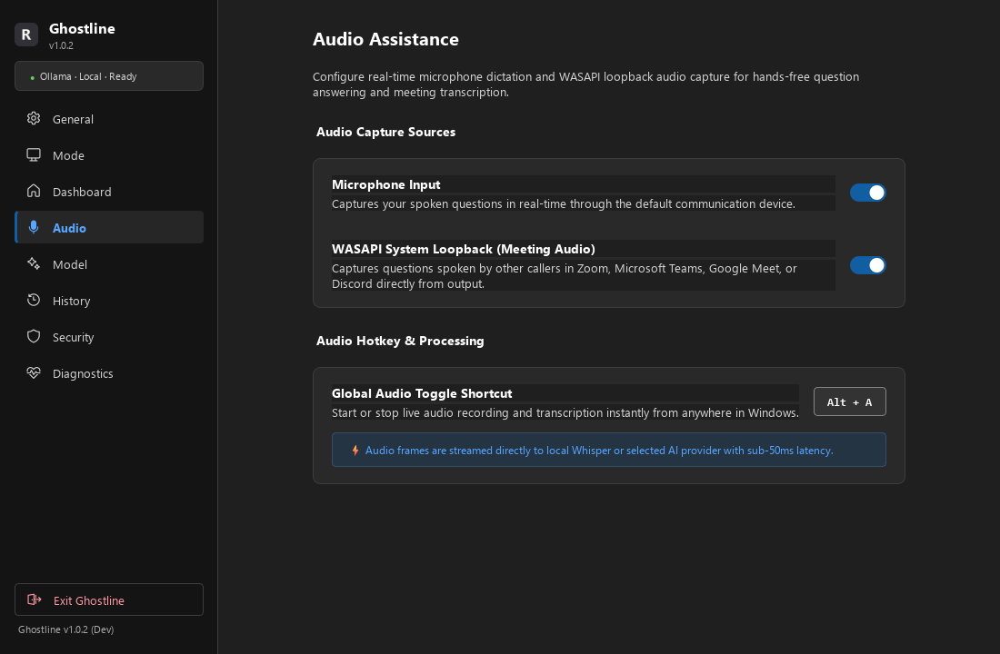

# Ghostline

Ghostline is a native Windows desktop assistive intelligence application for students, professionals, and job candidates. It provides on-screen question solving, live audio meeting transcription, personal experience profile grounding, and flexible AI model routing—supporting both private local models (via Ollama) and cloud providers (via Bring-Your-Own-Key).

Styled with Microsoft Fluent 2 Dark design language, Ghostline operates seamlessly on Windows 10 and 11.

---

## Visual Tour


*Fluent 2 Dark Main Dashboard with real-time status and quick actions*


*Floating HUD overlay displaying verified answers and explanation*


*Live Audio & Meeting Assistant with speaker attribution ([You] vs [Call])*

---

## 3-Step Quick Start

### 1. Download
Download the latest verified release from [Releases](../../releases/latest):
- **`Ghostline-Setup.exe`**: Standard Windows installer (recommended).
- **`Ghostline-v1.0.2-win64-portable.zip`**: Standalone portable package (no installation required).

### 2. Configure Your AI Provider
You can run completely on-device or connect to a cloud provider:
- **Local (Private)**: Install [Ollama](https://ollama.com) and pull your preferred model (e.g. `ollama run gemma2:2b`).
- **Cloud (BYOK)**: In Ghostline Settings → **AI Model**, choose OpenAI, Anthropic, Google Gemini, Groq, or OpenRouter and enter your API key. Keys are encrypted at rest using Windows DPAPI.

### 3. Use Hotkeys While Working
- **`Alt + /`**: Solves the question or multiple-choice prompt currently under your mouse cursor.
- **`Alt + Shift + /`**: Solves the full active screen.
- **`Alt + Q`**: Opens the Live Audio Copilot for ongoing calls or lectures.
- **`Alt + Shift + X`**: Instantly minimizes or hides the floating HUD.

---

## Where Your Data Goes

Ghostline is designed with transparent data boundaries. Depending on the provider you select, your data is handled as follows:

| Provider | Model Option | Screen / Audio Data Destination | API Key Storage | Internet Access Required |
| :--- | :--- | :--- | :--- | :---: |
| **Ollama (Local)** | `gemma2:2b`, `llama3.2`, etc. | **Never leaves your PC.** Processed locally over loopback (`127.0.0.1:11434`). | None needed | **No** |
| **OpenAI** | `gpt-4o`, `gpt-4o-mini` | Sent securely via HTTPS to `api.openai.com`. Subject to OpenAI API data policies. | Encrypted with Windows DPAPI | **Yes** |
| **Anthropic** | `claude-3-5-sonnet` | Sent securely via HTTPS to `api.anthropic.com`. Subject to Anthropic commercial API privacy. | Encrypted with Windows DPAPI | **Yes** |
| **Google Gemini** | `gemini-1.5-pro`, `gemini-1.5-flash` | Sent securely via HTTPS to `generativelanguage.googleapis.com`. Subject to Google Cloud privacy terms. | Encrypted with Windows DPAPI | **Yes** |
| **Groq** | `llama-3.3-70b-versatile` | Sent securely via HTTPS to `api.groq.com`. Subject to Groq API policies. | Encrypted with Windows DPAPI | **Yes** |
| **OpenRouter** | `auto` / custom | Sent securely via HTTPS to `openrouter.ai`. Routed to chosen model provider. | Encrypted with Windows DPAPI | **Yes** |

> [!NOTE]
> Ghostline includes built-in endpoint validation: cloud providers strictly enforce HTTPS. If you enter a custom endpoint on a non-default host, Ghostline prompts you with an interactive confirmation before any key or data is transmitted.

---

## System Tray Notes

Ghostline runs unobtrusively in your Windows Notification Area (System Tray):
- **Live Indicator**: The tray icon reflects system readiness and dynamic solve status.
- **Context Menu**: Right-click the tray icon to quickly access Settings, toggle between Local and Cloud modes, view Diagnostics, or quit the application.
- **Windows 11 Tip**: If the tray icon is tucked into the hidden overflow menu, click the `^` icon on the Windows taskbar and drag the Ghostline icon onto the main taskbar.

---

## Build from Source

### Prerequisites
- Windows 10 (64-bit, 20H2+) or Windows 11
- Python 3.10, 3.11, or 3.12
- Inno Setup 6 (optional, for compiling the native installer)

### Setup & Run
```powershell
# Clone the repository
git clone https://github.com/Mohammed-Ayyan/GhostLine.git
cd GhostLine

# Create and activate virtual environment
python -m venv .venv
.\.venv\Scripts\Activate.ps1

# Install dependencies
pip install -r requirements.txt

# Run in development mode
python ghostline/app.py --dev
```

### Build Executable & Packages
```powershell
# Run the automated release build script
python build_release.py
```
This produces:
- `dist/Ghostline/Ghostline.exe`
- `release_dist/Ghostline-Setup.exe`
- `release_dist/Ghostline-v1.0.2-win64-portable.zip`
- `release_dist/SHA256SUMS.txt`

---

## Testing & Quality Assurance

Ghostline maintains a comprehensive automated test suite:
```powershell
# Run all unit and regression tests
python -m pytest tests -q

# Run the offscreen DPI render harness across 100%, 125%, 150%, 200% scales
python tools/render_ui.py

# Run the headless self-test
python ghostline/app.py --self-test
```

---

## Ethical Use Notice

Ghostline is built for study, accessibility, mock interview preparation, and real-time meeting transcription. **Follow the rules of your school, employer, or interviewer.** Do not use Ghostline in proctored academic assessments, formal certification tests, or environments where assistive AI copilot tools are prohibited.

---

## License

This project is licensed under the [MIT License](LICENSE).  
Third-party component licenses and legal notices are cataloged in [THIRD_PARTY_NOTICES.md](THIRD_PARTY_NOTICES.md).
Security and responsible disclosure policies are documented in [SECURITY.md](SECURITY.md).
