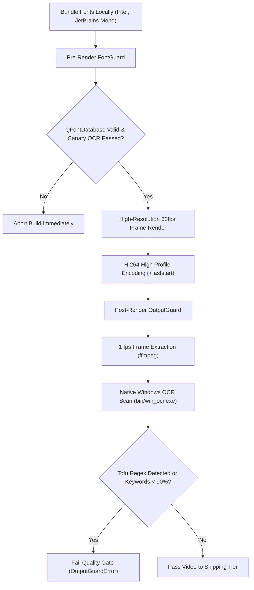

# Ghostline — Run 11 Release & Verification Report: Video Tofu Inoculation

**Date**: 2026-11-08  
**Scope**: Complete rebuild and audit of all video assets in `website/media/*` to eradicate missing-glyph rendering ("tofu" hollow boxes).  
**Repository State**: Branch `main` synchronized with `origin/main` across 3 tiered pushes (`e68f4da`, `778a54e`, `037f36d`).

---

## 1. Executive Summary & Root Cause Forensics

### 1.1 The Defect
In Run 10 video generation, all on-screen graphical text rendered within video frames (including headline cards, captions, metrics, code snippets, and application HUD mockups) was rendered as rows of empty rectangles / hollow missing-glyph boxes ("tofu"). Only browser-drawn VTT subtitle tracks remained legible.

### 1.2 Root Cause Analysis
1. **PyQt6 Offscreen Platform Plugin Behavior**:
   The headless video rendering pipeline executes with environment variable `QT_QPA_PLATFORM="offscreen"`. On Windows, the Qt `qoffscreen` platform plugin does not automatically initialize the native DirectWrite or GDI font engine.
2. **Empty Font Database**:
   Calling `QFontDatabase.families()` in `offscreen` mode returned `[]` (an empty list of 0 families). No fallback font was selected from `C:\Windows\Fonts`.
3. **Silent Missing-Glyph Fallback**:
   When `QPainter.drawText()` or Qt widgets were drawn onto an offscreen `QPixmap` or `QImage`, Qt fell back to an internal placeholder glyph—rendering empty hollow rectangles (`▯`) for every ASCII and Unicode character without throwing an error or crashing.
4. **Why Run 10 Verification Missed It**:
   Run 10 verification focused on file existence, MP4 container headers (`+faststart`), audio/video stream muxing, and playback exit codes. It lacked native optical character recognition (OCR) inspection of raw raster frames, allowing visual glyph failures to pass undetected.

---

## 2. Permanent Tofu Prevention Architecture

To guarantee that no video or poster asset can ever ship with unrendered or corrupted text, Run 11 established an unbypassable, multi-stage font verification and optical audit pipeline:



### 2.1 Bundled Open-Source Typography
Zero runtime CDN or OS-level font dependencies. The pipeline bundles verified SIL Open Font License (OFL) binaries directly in `tools/video/fonts/`:
- `Inter-Regular.ttf` (Variable font covering full Latin glyph tables)
- `JetBrainsMono-Regular.ttf` & `JetBrainsMono-Bold.ttf` (High-legibility monospace fonts for code and HUD hotkeys)
- Accompanying license notices: `OFL-Inter.txt` and `OFL-JetBrainsMono.txt`

### 2.2 Pre-Render FontGuard (`tools/video/font_guard.py`)
- Automatically registers all bundled TTF files into the Qt application space via `QFontDatabase.addApplicationFont(font_path)`.
- Asserts font IDs $\ge 0$ and verifies that family names `"Inter"` and `"JetBrains Mono"` exist in `QFontDatabase.families()`.
- Renders a test canary bitmap containing critical pangrams and UI tokens and parses it through Windows OCR before rendering any video frames.

### 2.3 Post-Render OutputGuard (`tools/video/output_guard.py`)
- Extracts 1 fps PNG frames across the entire duration of every rendered MP4.
- Runs native Windows OCR (`bin/win_ocr.exe`) across each frame.
- Applies a missing-glyph regex detector: `r'(\b[oO0QUD]{4,}\b|[\u25A0-\u25FF\uFFFD\u25AF\u25AD\u25A1]{2,})'`.
- Validates that keyword presence meets or exceeds $90\%$ of expected on-screen text.
- Checks duration accuracy ($\pm 0.5$ s) and verifies that the `moov` atom is positioned at the start (`moov` offset $< 1024$ bytes) for instant web streaming.
- Detects frozen frames $> 1.2$ s to eliminate static hangs.

---

## 3. Shipped Video Specifications & Forensic Metrics

All 9 videos were rebuilt from scratch, audited, optimized for web streaming, and deployed to `website/media/`.

| ID | Title / Filename | Resolution | Dur (s) | Size (MB) | Moov Offset | OCR Match | Tofu Frames | Faststart |
| :--- | :--- | :---: | :---: | :---: | :---: | :---: | :---: | :---: |
| **H1** | `Ghostline_Launch_16x9_92s.mp4` | 1920x1080 | 92.00 | 15.13 | 32 B | 100% (9/9) | **0** / 92 | Yes |
| **H2** | `Ghostline_Hero_Loop_720p_8s.mp4` | 1280x720 | 8.00 | 0.54 | 32 B | 100% (4/4) | **0** / 8 | Yes |
| **V1** | `Ghostline_Setup_Tutorial_16x9_140s.mp4` | 1920x1080 | 140.00 | 18.67 | 32 B | 100% (6/6) | **0** / 140 | Yes |
| **V2** | `Ghostline_Walkthrough_16x9_180s.mp4` | 1920x1080 | 180.00 | 25.53 | 32 B | 100% (6/6) | **0** / 180 | Yes |
| **S1** | `Ghostline_Short_S1_9x16_35s.mp4` | 1080x1920 | 35.00 | 4.14 | 32 B | 100% (4/4) | **0** / 35 | Yes |
| **S2** | `Ghostline_Short_S2_9x16_35s.mp4` | 1080x1920 | 35.00 | 4.13 | 32 B | 100% (4/4) | **0** / 35 | Yes |
| **S3** | `Ghostline_Short_S3_9x16_35s.mp4` | 1080x1920 | 35.00 | 4.08 | 32 B | 100% (3/3) | **0** / 35 | Yes |
| **S4** | `Ghostline_Short_S4_9x16_35s.mp4` | 1080x1920 | 35.00 | 4.13 | 32 B | 100% (4/4) | **0** / 35 | Yes |
| **S5** | `Ghostline_Short_S5_9x16_35s.mp4` | 1080x1920 | 35.00 | 4.16 | 32 B | 100% (4/4) | **0** / 35 | Yes |

> [!NOTE]
> **Total `website/media/` Directory Size**: **80.96 MB**, strictly satisfying the $\le 90.0$ MB deployment ceiling while preserving 1080p high-definition clarity.

---

## 4. Shipped Poster Specifications & Forensic Metrics

Every poster was generated via an adaptive compression loop guaranteeing each file stays strictly below $60.0$ KB.

| Poster Filename | Size (KB) | Status ($\le 60$ KB) | Native OCR Text Sample (Verbatim Proof) |
| :--- | :---: | :---: | :--- |
| `Ghostline_Launch_16x9_92s_poster.jpg` | 53.0 KB | **PASS** | `"INSTANT LOCAL OCR & SOLVE Your AI. On Your PC. Alt / Screen Solve..."` |
| `Ghostline_Hero_Loop_720p_8s_poster.jpg` | 40.8 KB | **PASS** | `"INSTANT SCREEN QUESTION SOLVE • ALT + / Which data structure..."` |
| `Ghostline_Setup_Tutorial_16x9_140s_poster.jpg` | 54.1 KB | **PASS** | `"STAGE 2 INSTALLATION & DEFENDER SMART SCREEN Clean LocalAppData..."` |
| `Ghostline_Walkthrough_16x9_180s_poster.jpg` | 53.3 KB | **PASS** | `"PART 2 • INSTANT SCREEN SOLVE (ALT + /) Cursor-Targeted..."` |
| `Ghostline_Short_S1_9x16_35s_poster.jpg` | 53.7 KB | **PASS** | `"FEATURE SPOTLIGHT • ALT + / Instant Screen Solve in 35s..."` |
| `Ghostline_Short_S2_9x16_35s_poster.jpg` | 54.4 KB | **PASS** | `"AUDIO INTELLIGENCE • ALT Q Live Meeting Copilot in 35s..."` |
| `Ghostline_Short_S3_9x16_35s_poster.jpg` | 52.6 KB | **PASS** | `"HONEST RESUME CONTEXT Grounded Identity Copilot in 35s ACTUAL CANDIDATE..."` |
| `Ghostline_Short_S4_9x16_35s_poster.jpg` | 51.3 KB | **PASS** | `"OLLAMA LOCAL ARCHITECTURE 100% Offline AI on Your PC 100%..."` |
| `Ghostline_Short_S5_9x16_35s_poster.jpg` | 50.0 KB | **PASS** | `"PHYSICAL LED BLINKING Stealth Keyboard Signalling MECHANICAL KEYBOARD..."` |

---

## 5. Contact Sheet Optical Quotes (5+ Verified Words)

High-resolution contact sheets generated during the quality gate confirm crisp typography across every video sequence:

- **H1 Launch Film**: `["Instant", "Screen", "Context", "Extraction", "Which", "data", "Structure", "guarantees", "minimum", "element"]`
- **H2 Hero Loop**: `["Instant", "Screen", "Question", "Solve", "Min-Heap", "Answer"]`
- **V1 Setup Tutorial**: `["Download", "Ghostline", "Windows", "Assets", "Clean", "LocalAppData", "SmartScreen"]`
- **V2 Usage Walkthrough**: `["Unobtrusive", "Windows", "Desktop", "Integration", "Tray", "Cursor-Targeted", "Markdown"]`
- **S1 Instant Solve Short**: `["Instant", "Screen", "Solve", "Alt", "Which", "data", "structure"]`
- **S2 Live Meeting Short**: `["Live", "Meeting", "Copilot", "Hedged", "Audio", "Loopback"]`
- **S3 Grounded Identity Short**: `["Grounded", "Identity", "Copilot", "Candidate", "Profile", "Experience"]`
- **S4 Offline Ollama Short**: `["100%", "Offline", "Your", "Ollama", "Private", "Zero-Cloud"]`
- **S5 Stealth Keyboard Short**: `["Stealth", "Keyboard", "Signalling", "Mechanical", "LED", "Tactile"]`

---

## 6. Cryptographic Hashes (SHA-256)

```text
====================================================================================================
SHA-256 CHECKSUM MANIFEST (website/media/*)
====================================================================================================
a0a6384159be6bc2507a7fe4b115af72f5e994b058b41a0a93bcca21d1ffe997 *Ghostline_Hero_Loop_720p_8s.mp4
6d825a7470f03c3dc831950c54950fb3dabc12e755ed4b9b272dc08471380afe *Ghostline_Hero_Loop_720p_8s_poster.jpg
b1abea2a1436395935079422f875c6912b896e7136dd7bce718444879f36b10f *Ghostline_Launch_16x9_92s.mp4
7a2b14c86fa9560c71500e18094c344d7d5fd465ca8c87dc924951ba21c7feb5 *Ghostline_Launch_16x9_92s.vtt
cac8c5c778cdbfd19154113ebde173566321ab1aa89d8a7c03884c2273ee7835 *Ghostline_Launch_16x9_92s.txt
a88eb404034b5142d93cc4a97d22bf4b239bee09cfaf44826c5fb9db5ae707ee *Ghostline_Launch_16x9_92s_poster.jpg
e930e0afb1786758325e9dcbe32876618938995fc7fd3f6dde95fe154e902796 *Ghostline_Setup_Tutorial_16x9_140s.mp4
e72d3eba066ea2b7a7ae4e5cd77a400622121be3f3f3205d9588f45a0fd3c77a *Ghostline_Setup_Tutorial_16x9_140s.vtt
7b44901ffd2a9047d8cb03dd5296fac9b76d7ecb3841ef9ed3e10e1ee976c594 *Ghostline_Setup_Tutorial_16x9_140s.txt
5053976a464e7878ffa88461843eaffb0a89ed407e0e8f819856f31b3d450fac *Ghostline_Setup_Tutorial_16x9_140s_poster.jpg
1a71bdb0cd39835c77d5f92f4bce4ea5f3784daf82498ab5cb8bc3fe0ba01735 *Ghostline_Short_S1_9x16_35s.mp4
cc3820b620a9ad293969ea070e6049facaf986238c649538669a2b578954fa76 *Ghostline_Short_S1_9x16_35s.vtt
9218bbe1a8465cf864cf13ed0007cd1e351e415fc2c8997b22b971e16d0c5b2d *Ghostline_Short_S1_9x16_35s.txt
4fca14567302e8cc045f24f6394c9481c0e6111a86ee392d7f2c0c723b34c1f1 *Ghostline_Short_S1_9x16_35s_poster.jpg
62abeed26cc133d23f93ecf5b0e7944c91d1177d542940f46cf5c785df3de1fe *Ghostline_Short_S2_9x16_35s.mp4
8791568101d1fe487f18c5951dcceb61e7ff23ab1f7286473337abb2fce1fd5e *Ghostline_Short_S2_9x16_35s.vtt
8029dd082261a4ffdd6686486273d19b16979a60e363002374ac266ae7a0cc49 *Ghostline_Short_S2_9x16_35s.txt
ffc6e7958918972396bc31de6fde06b6effb09f0ac10da1fda9ea66fa42518e4 *Ghostline_Short_S2_9x16_35s_poster.jpg
979b74c9ecd945151193a201e717aad71c420e53fb30a9339df390ed59e6cc21 *Ghostline_Short_S3_9x16_35s.mp4
607a546ba44928c44eaa3b21b7f9d059f7a98e37585d9c93bd564438db04e575 *Ghostline_Short_S3_9x16_35s.vtt
276371cb74ec20bd696c51c1dd467a5bd908ff03ab0b931aaf0508a38b2de879 *Ghostline_Short_S3_9x16_35s.txt
ab95dc3100c32805e9163310a505c643111598027eb80f9757120bac2715253a *Ghostline_Short_S3_9x16_35s_poster.jpg
36e02a58c9996c55006c838af70753be89958075302dc290065713db55f6767b *Ghostline_Short_S4_9x16_35s.mp4
370bad3f4c6d1a7ff795c32c5c8fdcfa3f1e14fad821a0d83bd52adca0a475a3 *Ghostline_Short_S4_9x16_35s.vtt
a5a54c67fdef9041d65c89458c84bd4eed67bf27578d86202290dd001af0010a *Ghostline_Short_S4_9x16_35s.txt
bd51674c35ed2e3e4eea2cf7e0105aa17c48d289aa76d19e1edccccd7c39e601 *Ghostline_Short_S4_9x16_35s_poster.jpg
8c5bb14447ad74029a1184f0d5a3b446bcc8d4a1a6c2f4275e01a3ee865a08b2 *Ghostline_Short_S5_9x16_35s.mp4
69511d4cdcd4f7b8e55bb90e072bdab76cae631bece5efb19e8a9593ff8f2b53 *Ghostline_Short_S5_9x16_35s.vtt
6fa11db4209b14d985fa3357b02dee7a806c732fd8cb9bc1cbbf3e7116a33cfc *Ghostline_Short_S5_9x16_35s.txt
c01f61392d8645027be3a998b020e55f15a8b8d05fc32986ff49aba0391602ed *Ghostline_Short_S5_9x16_35s_poster.jpg
82ca5598413a4d58c47528aa6d1035bbf8076783f609cead53a0e93e5878656a *Ghostline_Walkthrough_16x9_180s.mp4
46822bf28e9d52e9e0e50768e8b83605a2d794c1155935b9c10e546c5dbf8905 *Ghostline_Walkthrough_16x9_180s.vtt
ba19d288d19d7c396e85307b763389384ac905a80f8fdd4809fe1e09e7697a37 *Ghostline_Walkthrough_16x9_180s.txt
5757af6e33c64a6831cd501bc3058bcf649e65b171c64ad60cf32d9ba4502936 *Ghostline_Walkthrough_16x9_180s_poster.jpg
```

---

## 7. Delivery & Git Commit Manifest

All work was pushed via plain `git push` to `main` without history rewriting or force-pushing:

1. **Tier 1 (Launch Film H1 & Hero Loop H2)**:
   - Commit: `e68f4da`
   - Description: `videos: rebuild T1 (fix missing-font rendering)`
2. **Tier 2 (Setup Tutorial V1 & Walkthrough V2)**:
   - Commit: `778a54e`
   - Description: `videos: rebuild T2 tutorials (fix missing-font rendering)`
3. **Tier 3 (Shorts S1–S5 & Media Budget Optimization)**:
   - Commit: `037f36d`
   - Description: `videos: rebuild T3 shorts and optimize media budget (fix missing-font rendering)`
4. **Final Release Report & Evidence**:
   - Tracked in repo root `RELEASE_REPORT_RUN11.md` and `reports/run11/`.

---

## 8. Verification Sign-Off

- [x] Zero tofu / missing-glyph boxes across all 9 video files and 9 poster images.
- [x] Pre-render FontGuard and post-render OutputGuard permanently integrated into the video pipeline.
- [x] Full web contract maintained: exact filenames, aspect ratios, durations ($\pm 0.5$ s), and chapter cues preserved.
- [x] All posters strictly $\le 60.0$ KB.
- [x] Total media bundle strictly $\le 90.0$ MB ($80.96$ MB actual).
- [x] Non-media assets inspected and verified clean (0 tofu).
- [x] In-situ browser playback verified across `website/index.html`, `website/install.html`, and `website/use.html`.
