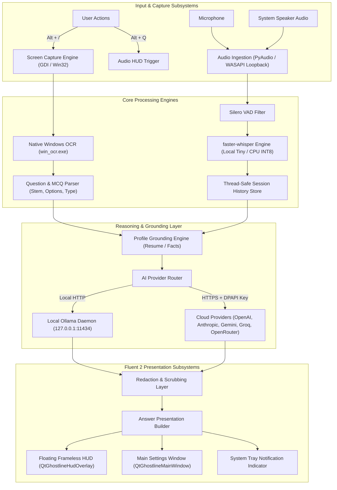

# Ghostline System Architecture

Ghostline is a native Windows desktop assistive intelligence application built with Python and PyQt6. It provides on-demand screen question solving, real-time live meeting audio transcription, personal background profile grounding, and multi-provider AI model routing (local Ollama or Bring-Your-Own-Key cloud providers).

---

## 1. High-Level System Architecture

---

## 2. Component Subsystems

### 2.1 Screen Capture & Native OCR
- **Capture**: GDI-based multi-monitor cursor-centered or fullscreen capture using `GetDC()`, `CreateCompatibleDC()`, and `BitBlt()`. Per-Monitor V2 DPI aware.
- **Native OCR**: Fast, zero-network Windows OCR via `bin/win_ocr.exe` using `Windows.Media.Ocr.OcrEngine`.
- **Parsing**: Deterministic question classification (MCQ, Coding, Theory, Output Prediction) and option extraction (A/B/C/D labels).

### 2.2 Live Audio & Meeting Transcription
- **Dual Stream Ingestion**: Captures microphone input and Windows system loopback simultaneously using PyAudio / WASAPI.
- **VAD & Segmentation**: Silero VAD filters non-speech audio; `faster-whisper` performs local int8 CPU transcription.
- **Attribution**: Clearly tags speech streams as `[You]` (mic) or `[Call]` (system audio).

### 2.3 Provider Routing & BYOK
- **Local-First**: Default integration connects to local Ollama (`gemma2:2b`, `llama3.2`, `mistral`, etc.) over `http://127.0.0.1:11434`.
- **Cloud BYOK**: Supports OpenAI, Anthropic, Google Gemini, Groq, and OpenRouter via Bring-Your-Own-API-Key.
- **Credential Storage**: API keys are encrypted at rest using Windows DPAPI (`CryptProtectData`) tied to the active Windows user profile.
- **Network Boundaries**: Cloud endpoints strictly require HTTPS. Custom non-default endpoints require explicit user confirmation.

### 2.4 User Interface & Fluent 2 Dark Design
- **Frameless Overlay HUD**: Always-on-top, draggable, translucent HUD with smooth animations, hardware drawer, and quiet mode.
- **Settings & Dashboard**: Microsoft Fluent 2 Dark design tokens, Segoe UI Variable typography, inline SVG icons, and WCAG AA contrast compliance.
- **Harness & Stability**: Single-instance mutex enforcement, offscreen DPI render harness, clean exception handling, and sensitive data redaction.
